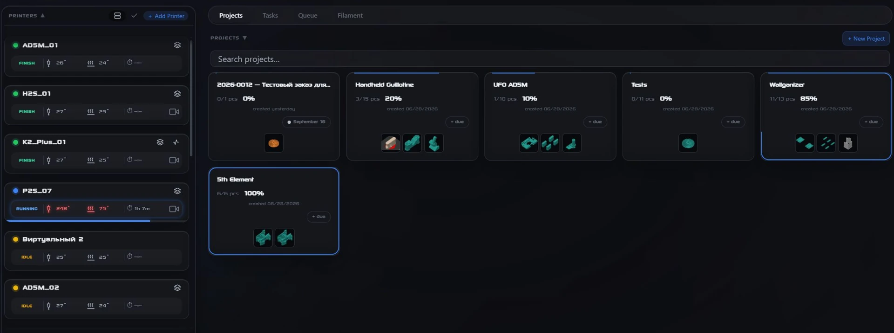
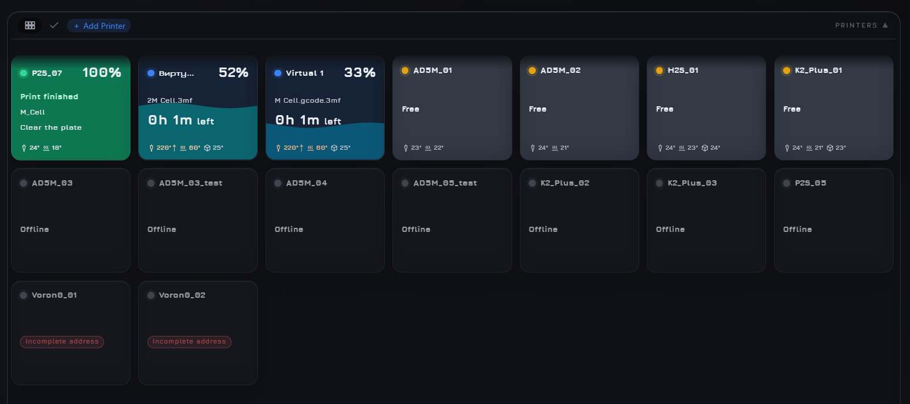
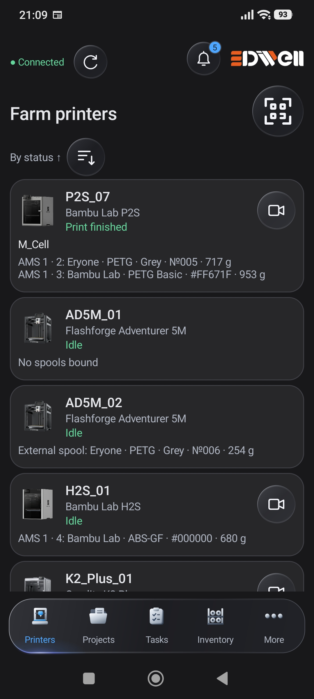
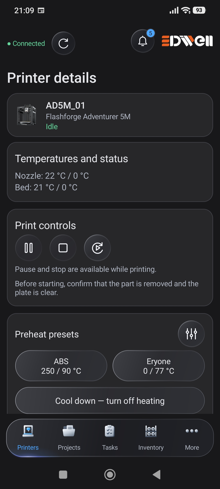

<p align="center">
  <picture>
    <source media="(prefers-color-scheme: dark)" srcset="assets/3diwell-dark.svg">
    <source media="(prefers-color-scheme: light)" srcset="assets/3diwell-light.svg">
    
  </picture>
</p>

<h1 align="center">Farm Manager</h1>

<p align="center"><strong>Your entire 3D printer farm, in one workspace.</strong><br>
Monitor printers, organize projects and manage print jobs from your farm computer.</p>

<p align="center"><a href="README.md">Русский</a> · <strong>English</strong></p>

<p align="center">
  <a href="https://3diwell.com/fm_3d/en/">Website &amp; downloads</a> ·
  <a href="https://github.com/3diwell/farm-manager/blob/main/docs/user/README.en.md">User guide</a> ·
  <a href="https://3diwell.com/fm_3d/en/#overview">Video walkthroughs</a> ·
  <a href="https://github.com/3diwell/farm-manager/issues">Report an issue</a>
</p>

<p align="center">Windows 10/11 x64 · Local network · Free, open-source core</p>

[](assets/projects-en.webp)

<p align="center"><sub>Printers on the left; projects and part completion on the right. Click the image for a closer look.</sub></p>

## Less switching. A clearer picture.

- **See the whole farm.** Printer states, print progress, remaining time and temperatures in one place.
- **Take projects through to completion.** Keep parts, files, quantities and progress together, then archive completed projects.
- **Manage print jobs.** Send prepared G-code and 3MF files to compatible printers and follow their progress.
- **Keep track of filament.** View available spool, AMS and CFS data. Add the separate Inventory module for stock management.
- **Keep your work local.** Farm Manager runs on the farm computer, where your files and databases are stored. Core operation does not require a cloud service.

<details>
<summary><strong>Another view: printer status dashboard</strong></summary>

[](assets/dashboard-en.png)

Printer cards help you find a running or available printer at a glance. The data shown depends on the device and its connection.

</details>

**Different brands in one application:**

| Brand / platform | Models and configurations |
|---|---|
| Bambu Lab | P1P · P1S · P1C · H2D · H2S · P2S |
| Flashforge | Adventurer 5M · Adventurer 5M Pro |
| Creality | K1 · K2 Plus · K2 Pro |
| ELEGOO | NEPTUNE 4 MAX |
| Klipper / Moonraker | Voron 0 · RatRig |
| Sovol | SV08 |
| FLSUN | T1 Max · V400 |

**K2 Pro:** camera support is currently in development and testing.

Voron 0 and RatRig are tested Klipper/Moonraker configurations; this does not guarantee support for every custom build. Testers have also verified Sovol SV08, FLSUN T1 Max, FLSUN V400 and Creality K1. Individual features depend on the printer firmware and configuration — [see compatibility details on the website](https://3diwell.com/fm_3d/en/#compatibility).

## Your farm on your phone

**FM for Android 0.16.0 · Alpha.** Check printer states, open projects and use the controls available to you from a phone on your local network.

<p align="center">
  <a href="assets/android-printers-en.jpg"></a>
  &nbsp;&nbsp;
  <a href="assets/android-printer-details-en.jpg"></a>
</p>

<p align="center"><sub>Farm overview and printer details. Actual app screenshots; click to enlarge.</sub></p>

Requires **Android 8.0+** and a running Farm Manager on the same network. Available features depend on the printer, installed modules and user permissions. QR and NFC spool operations require the Inventory module. The Android app is in alpha testing; full compatibility testing with FM 3.71 is not yet complete.

[More about the app and available builds →](https://3diwell.com/fm_3d/en/#android-download)

## Add the tools your farm needs

| Component | What it provides | Availability |
|---|---|---|
| Farm Manager core | Printers, projects, jobs, users and backups | Free and open source |
| Camera Wall, notifications, quality analytics, appearance | Extra tools and workspace customization | Free modules |
| Inventory and Order calculation | Stock management and print cost calculation | Separate paid modules |

Paid modules are distributed separately and are not included in this repository. See the [project website](https://3diwell.com/fm_3d/en/#modules) for terms and availability. [How to install modules →](https://github.com/3diwell/farm-manager/blob/main/docs/user/modules.en.md)

## Get started in three steps

1. **Choose an available release** on the [official website](https://3diwell.com/fm_3d/en/#download). Check the version and build status listed there.
2. **Install FM on a Windows 10/11 x64 computer** on the farm network. Follow the [installation and update guide](https://github.com/3diwell/farm-manager/blob/main/docs/user/install.en.md).
3. **Add compatible printers** and create your first project or job. To connect a phone, configure network access and a user account.

The current source version is **3.71 Beta** and is undergoing acceptance testing. Downloadable builds may differ from the source code. Make a [backup](https://github.com/3diwell/farm-manager/blob/main/docs/user/backup.en.md) before updating.

## Help and contributions

[User guide](https://github.com/3diwell/farm-manager/blob/main/docs/user/README.en.md) · [Telegram support](https://t.me/Sup3DiwellBot) · [Issues and suggestions](https://github.com/3diwell/farm-manager/issues)

When reporting a problem, include your FM version, printer model, steps to reproduce and expected result. Report vulnerabilities according to the [security policy](https://github.com/3diwell/farm-manager/blob/main/SECURITY.en.md).

<details>
<summary><strong>For developers: repository contents and running from source</strong></summary>

This repository contains the FM core, free modules, Android client and examples for module developers.

Python 3.14 is required:

```bash
python -m pip install -r requirements.txt
python server.py
```

The interface opens at `http://127.0.0.1:8000`. Some components of the official build, including ffmpeg and printer model images, are not included in the public source tree: [contents and exceptions](https://github.com/3diwell/farm-manager/blob/main/NOTICE.en.md).

[Building](https://github.com/3diwell/farm-manager/blob/main/docs/dev/building.en.md) · [Testing](https://github.com/3diwell/farm-manager/blob/main/docs/dev/testing.en.md) · [Contributing](https://github.com/3diwell/farm-manager/blob/main/CONTRIBUTING.en.md)

</details>

---

Code: [MPL 2.0](https://github.com/3diwell/farm-manager/blob/main/LICENSE). First-party documentation and screenshots: [CC BY 4.0](https://github.com/3diwell/farm-manager/blob/main/NOTICE.en.md), 3DiWell Team. Separate terms apply to [trademarks](https://github.com/3diwell/farm-manager/blob/main/TRADEMARKS.en.md), [third-party components](https://github.com/3diwell/farm-manager/blob/main/THIRD_PARTY_NOTICES.en.md) and paid modules.
