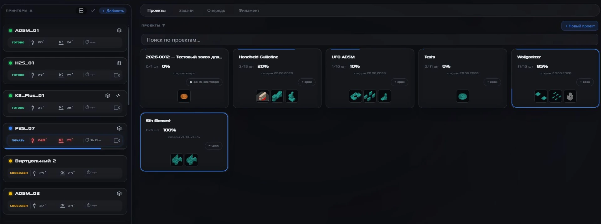
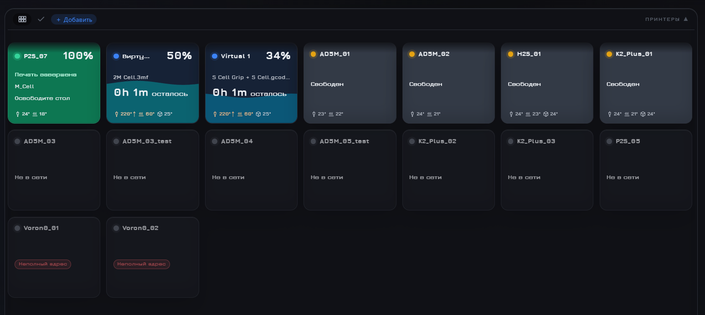
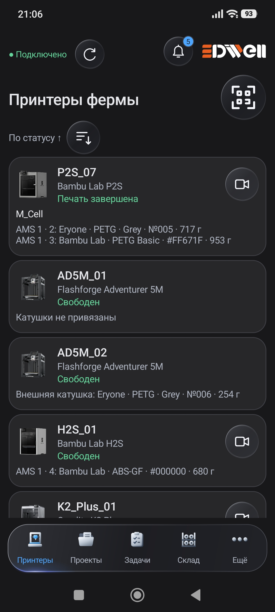
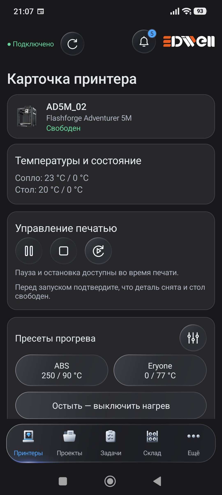

<p align="center">
  <picture>
    <source media="(prefers-color-scheme: dark)" srcset="assets/3diwell-dark.svg">
    <source media="(prefers-color-scheme: light)" srcset="assets/3diwell-light.svg">
    
  </picture>
</p>

<h1 align="center">Farm Manager</h1>

<p align="center"><strong>Вся 3D-ферма — в одном рабочем пространстве.</strong><br>
Следите за принтерами, ведите проекты и управляйте печатью с компьютера фермы.</p>

<p align="center"><strong>Русский</strong> · <a href="README.en.md">English</a></p>

<p align="center">
  <a href="https://3diwell.com/fm_3d/ru/">Сайт и загрузки</a> ·
  <a href="https://github.com/3diwell/farm-manager/blob/main/docs/user/README.md">Руководство</a> ·
  <a href="https://3diwell.com/fm_3d/ru/#overview">Видеообзоры</a> ·
  <a href="https://github.com/3diwell/farm-manager/issues">Сообщить об ошибке</a>
</p>

<p align="center">Windows 10/11 x64 · Локальная сеть · Бесплатное открытое ядро</p>

[](assets/projects-ru.webp)

<p align="center"><sub>Принтеры слева, проекты и готовность деталей справа. Нажмите на изображение, чтобы рассмотреть его.</sub></p>

## Меньше переключений. Больше ясности.

- **Видеть всю ферму.** Состояния принтеров, прогресс печати, время и температуры на одном экране.
- **Доводить проекты до результата.** Детали, файлы, количество и готовность хранятся вместе; завершённые проекты можно архивировать.
- **Управлять заданиями.** Отправляйте подготовленные G-code и 3MF на совместимые принтеры и следите за выполнением.
- **Следить за материалом.** Просматривайте доступные данные о катушках, AMS и CFS. Складской учёт подключается отдельным модулем.
- **Работать локально.** Farm Manager запускается на компьютере фермы; файлы и базы остаются у вас. Для основной работы обязательное облако не требуется.

<details>
<summary><strong>Ещё один экран: обзор состояний принтеров</strong></summary>

[](assets/dashboard-ru.png)

Карточки помогают быстро найти работающий или свободный принтер. Доступные данные зависят от устройства и подключения.

</details>

**Разные бренды в одной программе:**

| Бренд / платформа | Модели и конфигурации |
|---|---|
| Bambu Lab | P1P · P1S · P1C · H2D · H2S · P2S |
| Flashforge | Adventurer 5M · Adventurer 5M Pro |
| Creality | K1 · K2 Plus · K2 Pro |
| ELEGOO | NEPTUNE 4 MAX |
| Klipper / Moonraker | Voron 0 · RatRig |
| Sovol | SV08 |
| FLSUN | T1 Max · V400 |

**K2 Pro:** поддержка камеры сейчас в разработке и тестировании.

Voron 0 и RatRig относятся к протестированным конфигурациям Klipper/Moonraker; это не гарантия для всех пользовательских сборок. Тестерами также проверены Sovol SV08, FLSUN T1 Max, FLSUN V400 и Creality K1. Доступность отдельных функций зависит от прошивки и конфигурации принтера — [подробнее о совместимости на сайте](https://3diwell.com/fm_3d/ru/#compatibility).

## Ваша ферма — на экране телефона

**FM для Android 0.16.0 · Alpha.** Проверяйте состояние принтеров, открывайте проекты и управляйте доступными действиями с телефона в локальной сети.

<p align="center">
  <a href="assets/android-printers-ru.jpg"></a>
  &nbsp;&nbsp;
  <a href="assets/android-printer-details-ru.jpg"></a>
</p>

<p align="center"><sub>Обзор фермы и карточка принтера. Настоящие экраны приложения; нажмите для увеличения.</sub></p>

Нужны **Android 8.0+** и работающий Farm Manager в той же сети. Возможности зависят от принтера, модулей и прав пользователя. Операции с катушками по QR и NFC требуют модуля «Складской учёт». Android-приложение находится в альфа-тестировании; полная проверка совместимости с FM 3.71 ещё не завершена.

[Подробнее о приложении и доступных сборках →](https://3diwell.com/fm_3d/ru/#android-download)

## Добавьте инструменты под свою ферму

| Компонент | Что даёт | Доступность |
|---|---|---|
| Ядро Farm Manager | Принтеры, проекты, задания, пользователи и резервные копии | Бесплатно, открытый код |
| Видеостена, уведомления, аналитика качества, оформление | Дополнительные инструменты и настройка рабочего пространства | Бесплатные модули |
| Складской учёт и Расчёт заказа | Учёт запасов и расчёт стоимости печати | Отдельные платные модули |

Платные модули распространяются отдельно и не входят в этот репозиторий. Условия и доступность — [на сайте проекта](https://3diwell.com/fm_3d/ru/#modules). [Как устанавливать модули →](https://github.com/3diwell/farm-manager/blob/main/docs/user/modules.md)

## Начните с трёх шагов

1. **Выберите доступный выпуск** на [официальном сайте](https://3diwell.com/fm_3d/ru/#download). Учитывайте указанную там версию и статус сборки.
2. **Установите FM на компьютер с Windows 10/11 x64** в сети фермы. Порядок установки и обновления — [в руководстве](https://github.com/3diwell/farm-manager/blob/main/docs/user/install.md).
3. **Добавьте совместимые принтеры** и создайте первый проект или задание. Для доступа с телефона настройте сетевой доступ и пользователя.

Текущая версия исходного кода — **3.71 Beta**, выпуск проходит приёмку. Готовые сборки на сайте могут отличаться от исходников. Перед обновлением сохраните [резервную копию](https://github.com/3diwell/farm-manager/blob/main/docs/user/backup.md).

## Помощь и участие

[Руководство пользователя](https://github.com/3diwell/farm-manager/blob/main/docs/user/README.md) · [Поддержка в Telegram](https://t.me/Sup3DiwellBot) · [Ошибки и предложения](https://github.com/3diwell/farm-manager/issues)

При сообщении об ошибке укажите версию FM, модель принтера, шаги и ожидаемый результат. Об уязвимостях сообщайте по [правилам безопасности](https://github.com/3diwell/farm-manager/blob/main/SECURITY.md).

<details>
<summary><strong>Для разработчиков: состав и запуск из исходников</strong></summary>

В репозитории находятся ядро FM, бесплатные модули, Android-клиент и примеры для разработчиков модулей.

Нужен Python 3.14:

```bash
python -m pip install -r requirements.txt
python server.py
```

Интерфейс открывается по адресу `http://127.0.0.1:8000`. В открытой копии нет некоторых компонентов официальной сборки, включая ffmpeg и изображения моделей принтеров: [состав и исключения](https://github.com/3diwell/farm-manager/blob/main/NOTICE.md).

[Сборка](https://github.com/3diwell/farm-manager/blob/main/docs/dev/building.md) · [Проверки](https://github.com/3diwell/farm-manager/blob/main/docs/dev/testing.md) · [Как участвовать](https://github.com/3diwell/farm-manager/blob/main/CONTRIBUTING.md)

</details>

---

Код — [MPL 2.0](https://github.com/3diwell/farm-manager/blob/main/LICENSE). Собственная документация и скриншоты — [CC BY 4.0](https://github.com/3diwell/farm-manager/blob/main/NOTICE.md#документация-и-изображения--cc-by-40), команда 3DiWell. Для [товарных знаков](https://github.com/3diwell/farm-manager/blob/main/TRADEMARKS.md), [сторонних компонентов](https://github.com/3diwell/farm-manager/blob/main/THIRD_PARTY_NOTICES.md) и платных модулей действуют отдельные условия.
